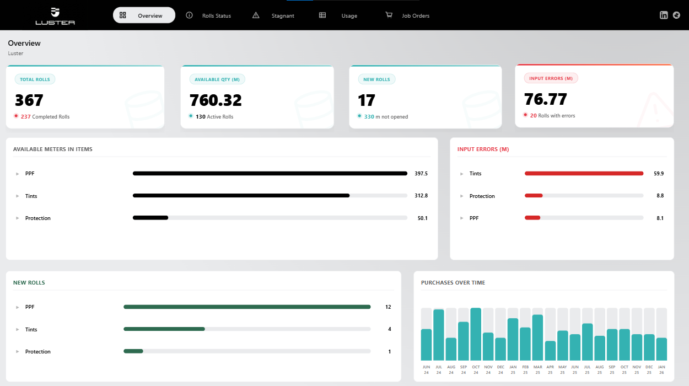
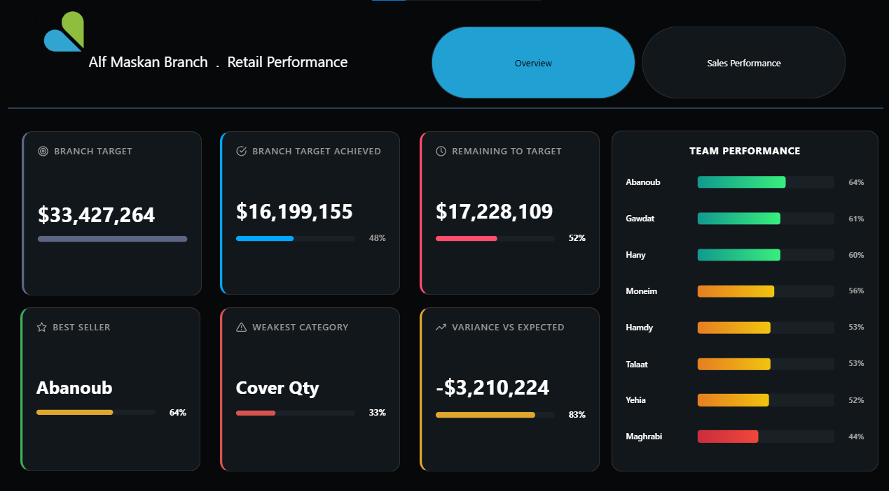

# Ahmed Serag Eldin
### Data Analyst & BI Developer

Turning raw, messy data into clean pipelines and dashboards that teams actually use.

---

## About

I'm a Data Analyst and BI Developer based in Assiut, Egypt. I work across the whole chain: extracting and cleaning raw data with **Python** and **SQL**, modelling it, and presenting it in interactive **Power BI** dashboards that decision-makers can read at a glance.

I spent a summer inside a retail sales team, so I build dashboards around the questions teams really ask: where are we behind, who needs support, and what should we focus on next.

- Cut client reporting time by **30%** with interactive Power BI dashboards
- Analysed datasets of **7,000+ records** end to end (ETL, modelling, visuals)
- Studying **B.Sc. Information Technology** at New Assiut Technological University

## Tech stack

**Also:** ETL & data cleaning · data modelling · EDA & statistics · feature engineering · KPI design · machine learning basics

## Featured projects

| Project | What it does | Tools |
|---|---|---|
| **LUSTER — Inventory & Consumption** | Five-page dashboard tracking film rolls: stock levels, low-stock and finished rolls, stagnant inventory ageing, usage per job order | Power BI, DAX, Excel |
| **Alf Maskan Branch — Retail Performance** | Branch target vs achieved, team ranking and category drill-down, built during my summer training with a retail sales team | Power BI, DAX |
| [**Amazon Products BI Dashboard**](https://mostaql.com/portfolio/3512141-amazon-products-bi-dashboard) | 1,000 products cleaned with Python, 4-page report covering pricing, brands and ratings with 20+ KPIs | Power BI, Python, DAX |
| [**Telecom Customer Churn**](https://mostaql.com/portfolio/3464637-customer-churn-dashboard) | Finds churn drivers across 7,043 customers: contract type, tenure and charges | Power BI, DAX, SQL |
| **Supermarket Sales Dashboard** | 5,010 orders analysed with an app-style dark UI and custom navigation | Power BI, Python |
| **COVID-19 Analysis & Forecast** | Full data-science cycle on Our World in Data, with a machine-learning forecast | Python, ML, Power BI |
| **Titanic Survival Prediction** | Exploratory analysis and a model that predicts survival | Python, ML |

  
  

## Experience

**Freelance Data Analyst & BI Developer** · Mostaql · Aug 2025 – Present
Power BI dashboards, Python/SQL ETL workflows, and technical proposals for clients.

**Data Analyst, Sales Team (Summer Training)** · Dream 2000, Retail Sales · 2026
Built a Power BI performance dashboard for the retail sales team after three months working inside it.

## About this repository

This repo is the source of my portfolio website, built with plain HTML, CSS and JavaScript (no frameworks, no build step) and hosted on GitHub Pages. It supports dark and light themes, English and Arabic (RTL), and works on mobile and desktop.

## Contact

- Email: [ahmedsalalh61@gmail.com](mailto:ahmedsalalh61@gmail.com)
- LinkedIn: [ahmed-serag11](https://www.linkedin.com/in/ahmed-serag11/)
- Freelance: [Mostaql](https://mostaql.com/u/Seraagg)

**محلل بيانات ومطوّر ذكاء أعمال · أسيوط، مصر**

